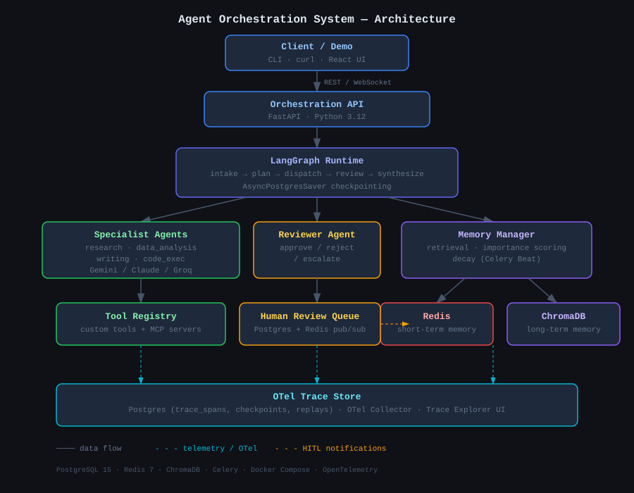
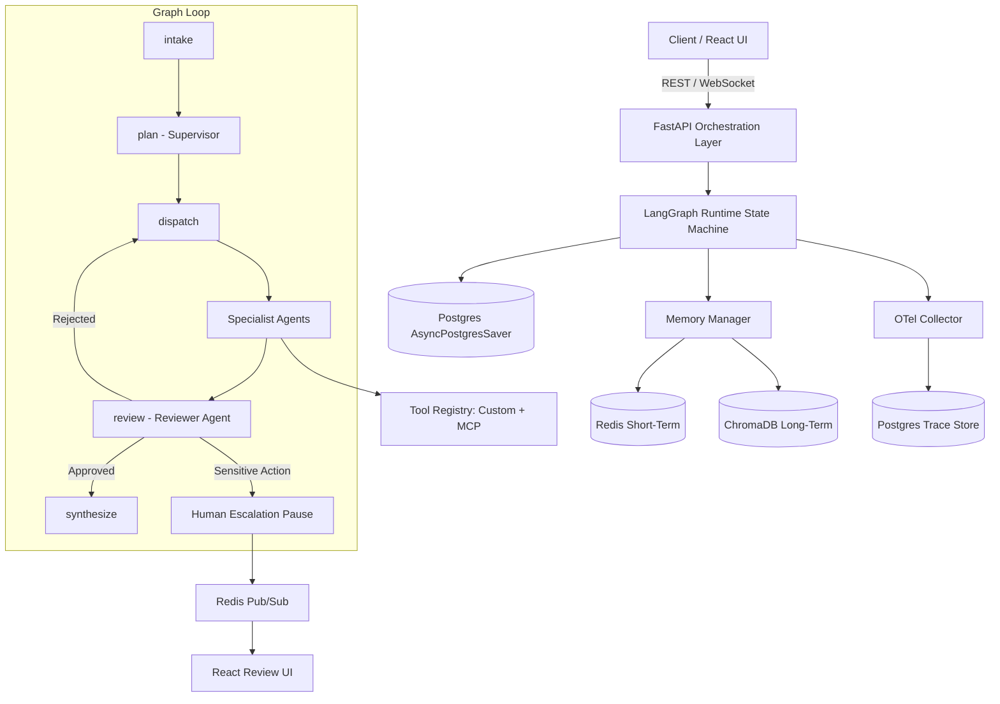

<div align="center">
  

  <p><strong>Production-grade autonomous multi-agent orchestration framework built with LangGraph, FastAPI, Redis, ChromaDB, and OpenTelemetry.</strong></p>
  
  <p>Decomposes complex natural-language tasks, delegates to specialized agents with bounded tools, validates outputs via a reviewer agent, retains long-term memory across sessions, escalates sensitive actions to a human operator, and provides full OTel observability with native checkpoint replay.</p>

  <p>
    <a href="https://github.com/GauravFrr/agent-orchestration"></a>
    <a href="https://github.com/GauravFrr/agent-orchestration"></a>
    <a href="https://github.com/GauravFrr/agent-orchestration/issues"></a>
    <a href="https://github.com/GauravFrr/agent-orchestration/stargazers"></a>
  </p>

  <p>
    <a href="#%EF%B8%8F-system-architecture">Architecture</a> •
    <a href="#-specialist-agents--tooling">Agents & Tools</a> •
    <a href="#-e2e-test-suite-results">E2E Benchmarks</a> •
    <a href="#%EF%B8%8F-api-endpoints-quick-reference">API Reference</a> •
    <a href="#%EF%B8%8F-quickstart--docker-setup">Setup</a> •
    <a href="#-running-the-demo">Demo Scenario</a>
  </p>
</div>

---

### Features

<table>
  <tr>
    <td width="33%"><strong>🤖 Multi-Agent Delegation</strong><br>Supervisor decomposes complex prompts into dependency graphs executed by specialized agents (Research, Analysis, Writing, Code Exec).</td>
    <td width="33%"><strong>🔄 LangGraph State Machine</strong><br>Typed state transitions backed by native <code>AsyncPostgresSaver</code> node checkpointing for pause/resume and full graph persistence.</td>
    <td width="33%"><strong>🧠 Dual Memory Engine</strong><br>Short-term execution state in Redis paired with long-term semantic retrieval in ChromaDB with background Celery decay.</td>
  </tr>
  <tr>
    <td width="33%"><strong>👁️ Self-Hosted Observability</strong><br>OTel collector captures full span trees, prompt &amp; response payloads, token usage, and cost rollups directly to PostgreSQL.</td>
    <td width="33%"><strong>🛡️ Human-in-the-Loop Safety</strong><br>Policy engine flags sensitive actions (e.g. SQL mutations) and pauses graph state, pushing real-time WebSocket alerts to the Review UI.</td>
    <td width="33%"><strong>⏪ Deterministic State Replay</strong><br>Re-execute any past task forward from a native LangGraph <code>checkpoint_id</code> with optional payload overrides for side-by-side comparison.</td>
  </tr>
</table>

<details>
  <summary><strong>Table of Contents</strong></summary>
  <ul>
    <li><a href="#%EF%B8%8F-system-architecture">🏗️ System Architecture</a></li>
    <li><a href="#-specialist-agents--tooling">🧬 Specialist Agents &amp; Tooling</a></li>
    <li><a href="#-e2e-test-suite-results">📊 E2E Test Suite Results</a></li>
    <li><a href="#%EF%B8%8F-api-endpoints-quick-reference">🛠️ API Endpoints Quick Reference</a></li>
    <li><a href="#-react-dashboard--trace-explorer">🖥️ React Dashboard &amp; Trace Explorer</a></li>
    <li><a href="#%EF%B8%8F-quickstart--docker-setup">⚙️ Quickstart &amp; Docker Setup</a></li>
    <li><a href="#-running-the-demo">🚀 Running the Demo</a></li>
    <li><a href="#%EF%B8%8F-design-decisions">💡 Design Decisions</a></li>
    <li><a href="#%EF%B8%8F-known-limitations">⚠️ Known Limitations</a></li>
    <li><a href="#-project-structure">📁 Project Structure</a></li>
  </ul>
</details>

---

## 🏗️ System Architecture

The following diagram details the end-to-end orchestration pipeline, execution graph, memory integration, and observability telemetry:



### Key Engineering Highlights

1. **Native LangGraph Checkpointing**: State is persisted at every graph node boundary using `AsyncPostgresSaver`. Pause/resume for HITL escalations and deterministic state replay read directly from native LangGraph checkpoint tables (`checkpoints` & `checkpoint_blobs`), eliminating state corruption during process restarts.
2. **Dual Tool Protocol**: The Tool Registry unifies native Python functions with external **Model Context Protocol (MCP)** tool servers behind a single standard execution interface.
3. **Self-Hosted Telemetry Pipeline**: OpenTelemetry spans are emitted across all graph nodes, LLM calls, and tool invocations, ingested by a local OTel Collector, and stored in Postgres (`trace_spans`) without any SaaS vendor locking.
4. **Memory-Augmented Planning**: Prior execution outcomes, user preferences, and domain facts are retrieved semantically from ChromaDB and injected into the Supervisor's prompt before graph decomposition.

---

## 🧬 Specialist Agents & Tooling

Specialist agents operate under strict tool allowlists and specific system prompts to enforce safety and prevent scope creep:

| Agent | Responsibilities | Allowed Tools | LLM Model |
| :--- | :--- | :--- | :--- |
| **Supervisor** | Task decomposition, dependency planning, final synthesis | Memory Read | Gemini `gemini-3.6-flash` (Default) / Claude / Groq |
| **Research Specialist** | Web search, document scanning, fact extraction | `web_search`, `file_read` | Multi-provider fallback |
| **Data Analysis Specialist** | SQL querying, dataset inspection, metric computation | `db_query`, `sandboxed_code_exec` | Multi-provider fallback |
| **Writing Specialist** | Formatting, report generation, summary composition | Memory Read | Multi-provider fallback |
| **Code Exec Specialist** | Python script execution, algorithm verification | `sandboxed_code_exec` | Multi-provider fallback |
| **Reviewer Agent** | Output verification against schemas and quality rubrics | Validation Engine | Multi-provider fallback |

---

## 📊 E2E Test Suite Results

The platform includes a comprehensive integration and E2E test suite running against real PostgreSQL, Redis, and ChromaDB containers:

```bash
docker exec agent_api pytest tests/e2e -v --asyncio-mode=auto
```

| Test File | Verified Architecture Flow | Status |
| :--- | :--- | :---: |
| `test_plan_decomposition.py` | Supervisor parses natural language into a dependency-ordered plan | **PASS 🟢** |
| `test_specialist_tool_use.py` | Research specialist executes `web_search` and records OTel span attributes | **PASS 🟢** |
| `test_reviewer_rejection_retry.py` | Low-quality output triggers reviewer rejection, returning feedback for subtask retry | **PASS 🟢** |
| `test_memory_informs_planning.py` | Semantic context from ChromaDB is injected into the Supervisor planning prompt | **PASS 🟢** |
| `test_human_escalation_timing.py` | Sensitive action pauses graph execution; state resumes upon posting decision | **PASS 🟢** |
| `test_agent_failure_recovery.py` | Exception during tool execution transitions task state cleanly to `failed` | **PASS 🟢** |

---

## 🛠️ API Endpoints Quick Reference

FastAPI exposes an interactive OpenAPI documentation page at `http://localhost:8000/docs`.

### 1. Submit New Task (`POST /tasks`)
```bash
curl -X POST "http://localhost:8000/tasks" \
     -H "Content-Type: application/json" \
     -d '{
       "request_text": "Research recent agent orchestration trends, query sales churn data, and compile a report."
     }'
```

### 2. Fetch Trace Tree & Cost Rollup (`GET /tasks/{id}/trace`)
```bash
curl -X GET "http://localhost:8000/tasks/1f1a84df-36e9-683e-8000-2639f41c4785/trace"
```
**Response Payload:**
```json
{
  "task_id": "1f1a84df-36e9-683e-8000-2639f41c4785",
  "spans": [
    {
      "span_id": "a1b2c3d4",
      "name": "NODE plan",
      "duration_ms": 847,
      "cost_usd": 0.000142,
      "attributes": {
        "checkpoint_id": "446ee64b-c8ec-4f0f-b588-a2be680ad27b",
        "llm.prompt_tokens": 1842,
        "llm.completion_tokens": 312
      }
    }
  ],
  "total_cost_usd": 0.000432
}
```

### 3. Replay Task from Checkpoint (`POST /tasks/{id}/replay`)
```bash
curl -X POST "http://localhost:8000/tasks/1f1a84df-36e9-683e-8000-2639f41c4785/replay" \
     -H "Content-Type: application/json" \
     -d '{
       "checkpoint_id": "446ee64b-c8ec-4f0f-b588-a2be680ad27b",
       "input_override": {"t1_input": "Focus exclusively on open-source agent frameworks."}
     }'
```

---

## 🖥️ React Dashboard & Trace Explorer

The React + TypeScript frontend (`http://localhost:3000`) provides three primary operational views:

1. **🛡️ Human Review Queue (`/reviews`)**: Real-time WebSocket notifications alert operators when a task pauses due to sensitive action triggers. Operators can inspect context and issue `APPROVE_ACTION`, `REJECT`, `MODIFY`, or `TAKE_OVER` decisions.
2. **👁️ Trace Explorer (`/traces`)**: Visualizes hierarchical OTel span trees with color-coded nodes, prompt/response detail drawers, token usage metrics, cost rollups, and interactive replay triggers.
3. **🧠 Memory Dashboard (`/memory`)**: Displays short-term Redis cache entries alongside semantic ChromaDB long-term memories with importance scores and decay rates.

---

## ⚙️ Quickstart & Docker Setup

### Prerequisites
- Docker and Docker Compose installed
- Google Gemini API Key (or set `MOCK_PROVIDERS=true` for local dry runs)

### 1. Clone & Configure Environment
```bash
git clone https://github.com/GauravFrr/agent-orchestration.git
cd agent-orchestration
cp .env.example .env
```
Edit `.env` and configure your API key:
```env
GEMINI_API_KEY="your-gemini-api-key-here"
DEFAULT_MODEL_GEMINI="gemini-3.6-flash"
MOCK_PROVIDERS=false
```

### 2. Launch Full Stack with Docker Compose
```bash
docker-compose up --build
```
This spins up PostgreSQL 15, Redis 7, ChromaDB, OTel Collector, Celery Worker, Celery Beat, FastAPI Backend, and Vite React Frontend.

---

## 🚀 Running the Demo

Run the end-to-end automated demo script to witness task decomposition, tool execution, reviewer rejection-and-retry, HITL escalation, memory integration, and trace replay:

```bash
bash demo/demo.sh
```

Or execute the Python scenario directly:
```bash
python demo/demo_scenario.py
```

---

## 💡 Design Decisions

* **Why LangGraph instead of a custom state machine?** LangGraph supplies typed graph states, conditional routing, and native Postgres checkpointing via `AsyncPostgresSaver`. State is saved at every node transition, making HITL pause/resume completely resilient to API restarts.
* **Why real MCP integration?** Standardizing on the Model Context Protocol allows connecting any external MCP tool server (filesystem, browser, APIs) without changing specialist agent implementation code.
* **Why React over Streamlit?** Real-time WebSocket review alerts, interactive span trees, and side-by-side replay modal comparisons require client-state management that fights Streamlit's full-rerun execution model.
* **Why self-hosted OTel?** Ingesting OpenTelemetry spans locally via Postgres eliminates external SaaS costs, preserves prompt data privacy, and operates without external network dependencies.

---

## ⚠️ Known Limitations

1. **`sandboxed_exec` uses subprocess timeout only (Phase 1)**: Subprocess execution is restricted by timeout and stripped environment variables, but lacks Linux `seccomp`/`nsjail` namespace isolation. Production usage requires dedicated container sandboxing.
2. **Supervisor planning uses free-text JSON prompting (Phase 1)**: Gemini API's `response_schema` constraint on nested dictionaries requires parsing the Supervisor plan via `json.loads` + `Plan(**plan_dict)` rather than native structured output.
3. **In-memory `_SPAN_TASK_MAP` is per-process (Phase 4)**: The OTel tracer maps `span_id` → `task_id` in process memory. Moving specialists to external worker nodes will require migrating this mapping table to Redis.
4. **Gemini free-tier rate limits (500 req/day)**: Running real LLM E2E tests continuously triggers 429 rate limits. Mitigated by exponential backoff (up to 10 retries, max 120s delay in `app/providers/gemini.py`), or bypassable via `MOCK_PROVIDERS=true`.

---

## 📁 Project Structure

```
agent-orchestration/
├── backend/
│   ├── app/
│   │   ├── agents/          # Supervisor, Specialists, Reviewer
│   │   ├── api/routes/      # Tasks, Reviews, Memory, Traces
│   │   ├── core/            # Config, Schemas, Cost calculation
│   │   ├── graph/           # LangGraph nodes, build_graph, checkpointing
│   │   ├── hitl/            # Escalation triggers & approval queue
│   │   ├── memory/          # Redis short-term, ChromaDB long-term, Celery decay
│   │   ├── observability/   # OTel setup, PostgresSpanProcessor
│   │   ├── providers/       # Gemini, Claude, Groq wrappers
│   │   ├── replay/          # Replay engine logic
│   │   └── tools/           # Registry, web_search, db_query, sandboxed_exec, MCP client
│   ├── db/                  # SQLAlchemy models & migrations
│   └── tests/e2e/           # 6 E2E integration test suites
├── frontend/                # React + TypeScript Vite frontend
├── demo/                    # Scripted demo scenario & bash wrapper
├── docs/                    # SVG Architecture diagram
├── .github/workflows/       # CI & Security scan workflows
├── docker-compose.yml       # Complete multi-container deployment
└── README.md
```

---

<div align="center">
  <sub>Built by <a href="https://github.com/GauravFrr">Gaurav</a> — Production Autonomous Agent Orchestration Framework</sub>
</div>
